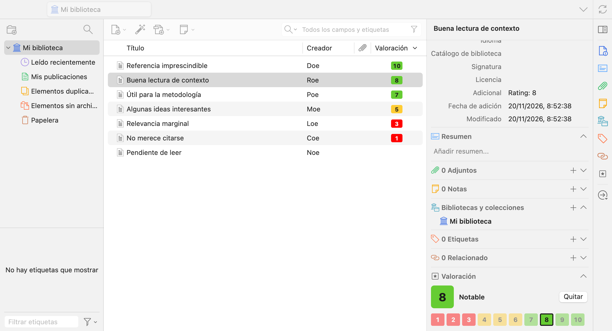

# Valoración para Zotero

[English](README.md) | Español

Valora los elementos de tu biblioteca de Zotero del 1 al 10 y consulta la puntuación de un vistazo, en el panel del elemento y en una columna ordenable.



## Qué hace

- **Sección Valoración** en el panel del elemento: pulsa un número para valorar el elemento o *Quitar* para borrar la valoración. Con la sección plegada, la cabecera muestra la puntuación (`8/10`).
- **Columna Valoración** en la lista de elementos. Pulsa su cabecera para ordenar de mejor a peor; los elementos sin valorar quedan al final.
- **Franjas de color** para recorrer una lista con rapidez: verde de 7 a 10, ámbar de 4 a 6 y rojo de 1 a 3.
- **Sin base de datos aparte.** La valoración es una línea del campo Adicional (Extra) del elemento (`Rating: 8`), así que se sincroniza con tu biblioteca, viaja con las exportaciones y se puede buscar como cualquier otro campo.
- Los cambios de valoración se pueden deshacer con Editar → Deshacer (Zotero 10).
- Disponible en **español e inglés**, según el idioma de Zotero.

## Instalación

1. Descarga el archivo `.xpi` más reciente desde la [página de versiones](https://github.com/Wences91/zotero-valoracion/releases/latest). En Firefox, haz clic derecho en el enlace y elige *Guardar enlace como…*; de lo contrario Firefox intenta instalarlo él mismo.
2. En Zotero, abre *Herramientas → Extensiones*, pulsa el icono del engranaje, elige *Install Plugin From File…* y selecciona el archivo descargado.
3. Para mostrar la columna, haz clic derecho sobre las cabeceras de la lista de elementos y marca *Valoración*.

Zotero instala las versiones posteriores automáticamente.

Requiere Zotero 7 o posterior. Desarrollado y probado en Zotero 10.

## Cómo se guardan las valoraciones

La valoración es una línea del campo Adicional del elemento:

```
Rating: 8
```

El complemento solo toca esa línea; el resto del campo queda como estaba. Esto también permite:

- escribir o editar la línea a mano, o borrarla para quitar la valoración;
- encontrar elementos por valoración con una búsqueda avanzada sobre Adicional, por ejemplo *Adicional contiene* `Rating: 9`;
- conservar las valoraciones aunque dejes de usar el complemento.

Las líneas escritas como `Valoración: 8` por la versión 1.0.0 se siguen leyendo, y pasan a `Rating: 8` la próxima vez que se valore el elemento.

## Desarrollo

El complemento no tiene dependencias de compilación. El código está en `src/` y se empaqueta tal cual.

```bash
scripts/build.sh
```

crea `build/zotero-valoracion-<versión>.xpi` y regenera `updates.json` para esa versión. El archivo es reproducible: compilar dos veces el mismo código da el mismo hash.

```bash
scripts/smoke-test.sh
```

instala el complemento en un Zotero real con un perfil y una biblioteca temporales, lo maneja a través de la interfaz e informa del resultado (solo macOS). No toca tu perfil ni tu biblioteca y puede ejecutarse con tu Zotero abierto. Indica un idioma para probar una traducción, por ejemplo `scripts/smoke-test.sh es-ES`.

Para publicar una versión: actualiza `version` en `src/manifest.json` y el registro de cambios, ejecuta `scripts/build.sh`, haz el commit y crea una versión en GitHub con la etiqueta `v<versión>` y el `.xpi` adjunto. Las copias instaladas encuentran la actualización mediante `updates.json` en la rama `main`.

### Traducciones

Cada idioma es una carpeta en `src/locale/` con un archivo `valoracion.ftl`, más una carpeta en `src/_locales/` con el nombre y la descripción del complemento. Para añadir un idioma, copia las carpetas `en-US` y `en`, cámbiales el nombre y traduce los textos.

## Licencia

[MIT](LICENSE)

## Declaración de uso de IA

El código de este complemento se escribió con Claude (Anthropic) bajo la dirección del autor. Claude se usa además para tareas de edición y organización en este repositorio mediante la [skill](https://support.claude.com/en/articles/12512176-what-are-skills) [session-wrap-up](https://github.com/Wences91/session-wrap-up). Revisa los cambios, identifica posibles errores y los anota, con sugerencias, en las notas privadas del autor. También actualiza este README y los archivos de requisitos, corrige la ortografía de los comentarios del código y prepara los commits que el autor aprueba antes de subirlos.
