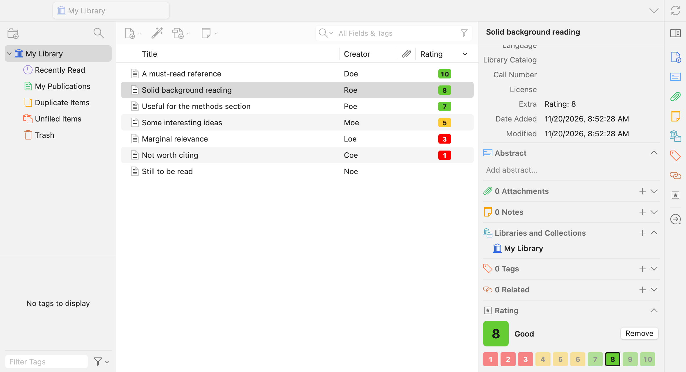

# Item Rating for Zotero

English | [Español](README.es.md)

Rate the items in your Zotero library from 1 to 10 and see the score at a glance, in the item pane and in a sortable column.



## Features

- **Rating section** in the item pane: click a number to rate the item, or *Remove* to clear the rating. When the section is collapsed, its header shows the score (`8/10`).
- **Rating column** in the items list. Click its header to sort from best to worst; unrated items go last.
- **Color bands** so that a list can be scanned quickly: green for 7–10, amber for 4–6, red for 1–3.
- **No separate database.** A rating is a line in the item's Extra field (`Rating: 8`), so it syncs with your library, travels with exports and can be searched like any other field.
- Rating changes can be undone with Edit → Undo (Zotero 10).
- Available in **English and Spanish**, following Zotero's language.

## Installation

1. Download the latest `.xpi` file from the [releases page](https://github.com/Wences91/zotero-valoracion/releases/latest). In Firefox, right-click the link and choose *Save Link As…*, otherwise Firefox tries to install it itself.
2. In Zotero, open *Tools → Plugins*, click the gear icon and choose *Install Plugin From File…*, then select the downloaded file.
3. To show the column, right-click the column headers of the items list and tick *Rating*.

Zotero installs later versions automatically.

Requires Zotero 7 or later. Developed and tested on Zotero 10.

## How ratings are stored

The rating is one line in the item's Extra field:

```
Rating: 8
```

The plugin only touches that line; anything else in Extra is left as it is. This also means you can:

- type or edit the line by hand, or delete it to remove the rating;
- find items by rating with an advanced search on Extra, for example *Extra contains* `Rating: 9`;
- keep your ratings if you stop using the plugin.

Lines written as `Valoración: 8` by version 1.0.0 are still read, and are rewritten as `Rating: 8` the next time the item is rated.

## Development

The plugin has no build dependencies. The sources are in `src/` and are packaged as they are.

```bash
scripts/build.sh
```

creates `build/zotero-valoracion-<version>.xpi` and regenerates `updates.json` for that version. The archive is reproducible, so building the same sources twice gives the same hash.

```bash
scripts/smoke-test.sh
```

installs the plugin in a real Zotero running on a temporary profile and library, drives it through the interface and reports the result (macOS only). It does not touch your own profile or library and can run while your Zotero is open. Pass a locale to test a translation, for example `scripts/smoke-test.sh es-ES`.

To publish a version: update `version` in `src/manifest.json` and the changelog, run `scripts/build.sh`, commit, and create a GitHub release tagged `v<version>` with the `.xpi` attached. Installed copies find the update through `updates.json` on the `main` branch.

### Translations

Each language is a folder in `src/locale/` with a `valoracion.ftl` file, plus a folder in `src/_locales/` with the plugin name and description. To add a language, copy the `en-US` and `en` folders, rename them and translate the texts.

## License

[MIT](LICENSE)
